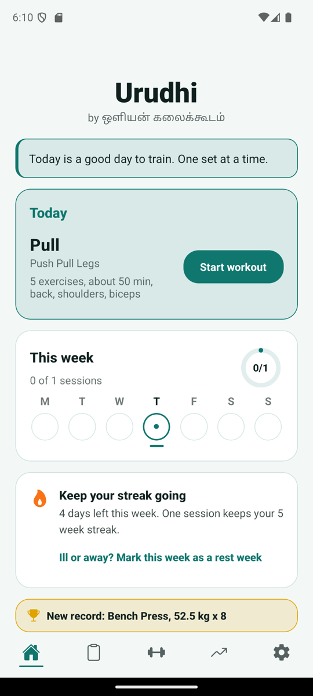
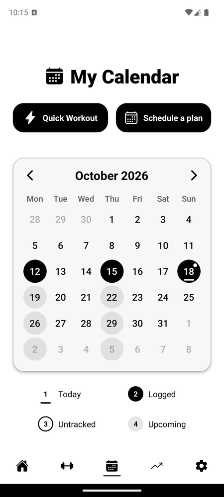
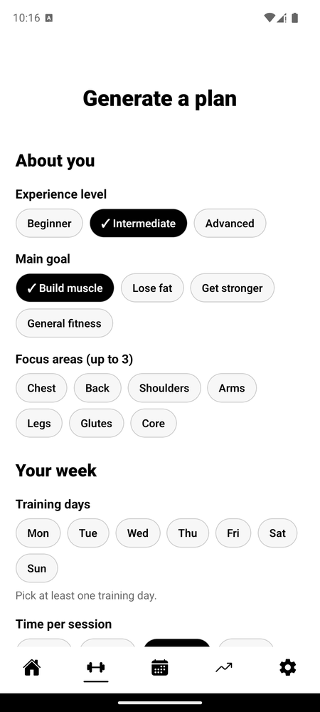
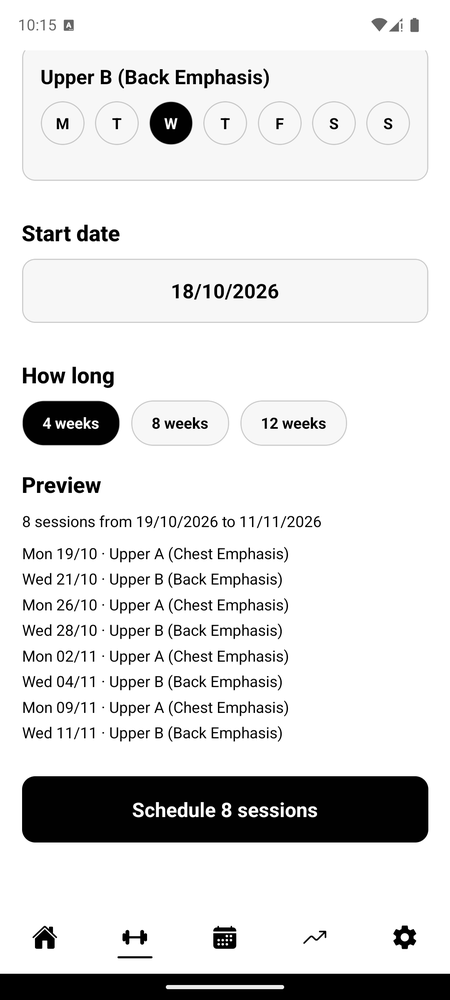
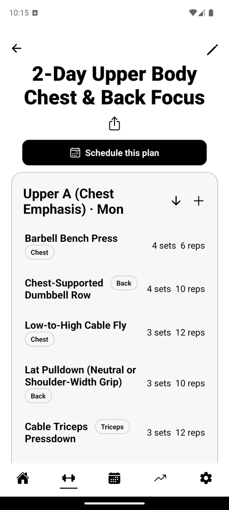
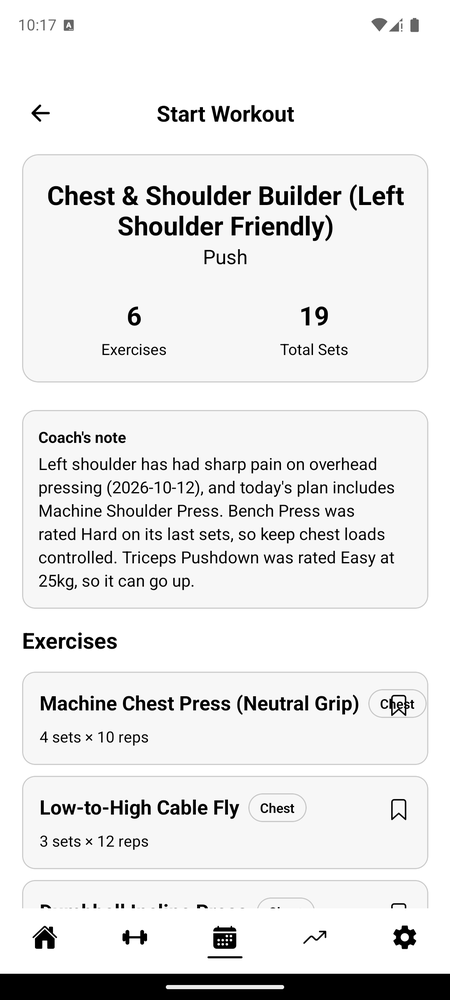
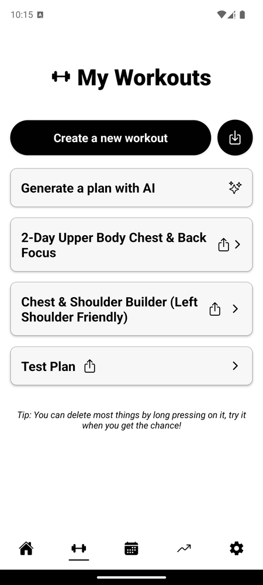
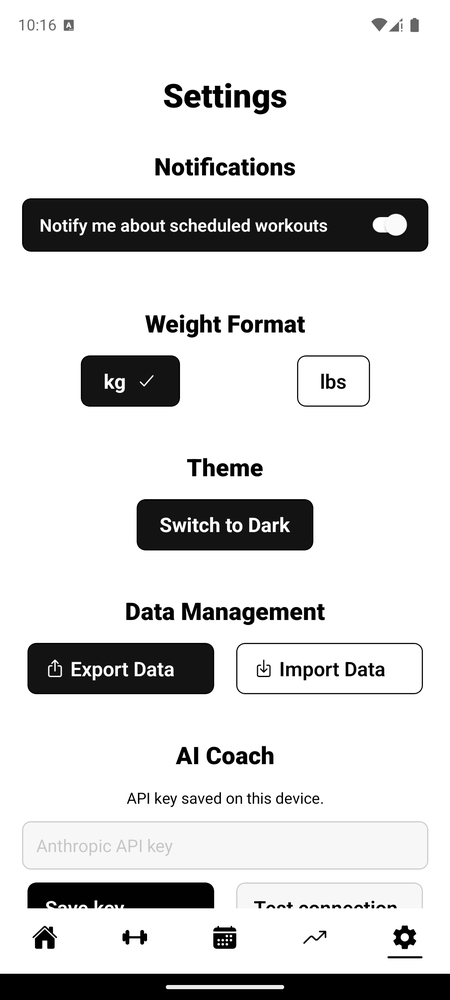

<div align="center">


# **Urudhi**

**by ஒளியன் கலைக்கூடம்**

</div>

Urudhi is a small, quiet fitness app: build a plan, put it on your calendar, do the workout, and watch yourself get stronger. Everything is stored on your phone. An optional **AI Coach** can write a plan for you and leave notes before a workout, using your own Anthropic API key.

> Urudhi is a fork of [Simple Fitness](https://github.com/basarsubasi/simplefitnessapp) by Başar Subaşı, released under the MIT License.

<table align="center">
  <tr>
    <td align="center"><br><sub><b>Home</b><br>Today, your week, streak</sub></td>
    <td align="center"><br><sub><b>Calendar</b><br>Everything scheduled</sub></td>
    <td align="center"><br><sub><b>AI plan form</b><br>Tap, don't type</sub></td>
    <td align="center"><br><sub><b>Schedule a plan</b><br>4, 8 or 12 weeks</sub></td>
  </tr>
  <tr>
    <td align="center"><br><sub><b>A plan</b><br>Each day has a weekday</sub></td>
    <td align="center"><br><sub><b>Start workout</b><br>With the coach's note</sub></td>
    <td align="center"><br><sub><b>Workout Plans</b><br>Create, import, generate</sub></td>
    <td align="center"><br><sub><b>Settings</b><br>Backup, theme, AI Coach</sub></td>
  </tr>
</table>

**Contents:** [Features](#-features) · [Install](#-install) · [Using the app](#-using-the-app) · [AI Coach](#-ai-coach-optional) · [Privacy](#-privacy) · [Troubleshooting](#-troubleshooting) · [Build from source](#-build-from-source) · [License](#-license)

## 🚀 **Features**

- 🏠 **A dashboard** for today's workout, your week at a glance, your weekly streak, how much you lifted, and your latest personal records.
- 🏋️ **Create workouts** with days, exercises, sets and reps. Give each day a weekday (for example Push on Monday).
- 📅 **Schedule a whole plan** in one go: pick a start date and 4, 8 or 12 weeks, and every day lands on its weekday.
- ⏱️ **Do a workout** with rest timers that vibrate, play a sound and notify you; weights and reps are filled in from last time; rate each set and add comments.
- 📊 **Track progress** with logs and graphs.
- 🔁 **Share** a workout as a small file and import workouts others have shared.
- 🤖 **AI Coach (optional):** a note before each workout, and AI-generated plans you can refine, save and schedule.
- 🎨 Light and dark themes. Weights are in `kg`. Dates are `dd/mm/yyyy`, time is 12-hour, weeks start on Monday. English only.
- 💾 Export and import all your data.

## ⬇️ **Install**

Urudhi is not on any app store yet. Choose one:

- **Download:** get the latest APK from the [GitHub Releases](https://github.com/oliyan/urudhi/releases) page, copy it to your Android phone and open it. Android will ask you to allow installing from that source.
- **Build it yourself:** see [Build from source](#-build-from-source).

Android only for now.

## 📖 **Using the app**

The bottom bar has five tabs: **Home**, **Workout Plans** (clipboard), **Sessions** (dumbbell), **My Progress** and **Settings**.

### 1. The Home dashboard

Home shows what matters today:

- **Today:** the workouts scheduled for today. Tap **Start workout** to begin one, or see **Done** once it is logged. On a rest day it shows what is next.
- **This week:** Monday to Sunday. A filled circle with a tick means done, a ringed circle means planned, a dashed circle means missed. Tap it to open the calendar.
- **Week streak:** how many weeks in a row you logged at least one workout. A new week with nothing logged yet does not break your streak.
- **Lifted this week:** total weight × reps this week, compared with last week.
- **Recent personal records:** the last times you lifted more than ever before on an exercise (the very first time you do an exercise only sets the starting point).

On a fresh install Home shows a welcome card with buttons to create a workout or generate a plan.

### 2. Settings you may want to change (one time)

Open **Settings** (gear icon).

- **Theme:** switch between light and dark.
- **Notifications:** turn on to be able to set reminders for a scheduled workout.

Dates, the 12-hour clock and the Monday-first week are fixed; there is nothing to set.

### 3. Create a workout

1. Open **Workout Plans** and tap **Create new workout plan**.
2. Give it a name and add one or more **days** (for example "Push", "Pull", "Legs").
3. For each day, tap a **weekday** (M T W T F S S) if the day belongs to a particular day of the week. Tap it again to clear it. This is optional.
4. Add **exercises** with sets and reps, and tag each with a muscle group if you like.
5. Save it.

Other ways to get a workout:
- **Import** (the download-arrow button next to Create): load a `.json` file someone shared with you.
- **Generate a plan with AI:** see [AI Coach](#-ai-coach-optional).

To change a workout, open it and use the pencil icon (names, weekdays, exercises, order), the plus icon on a day to add an exercise, or the arrows to move a day. To share one, tap the share icon. To delete one, long-press it.

### 4. Put it on your calendar

**A whole plan.** Open the workout and tap **Schedule this plan**, or tap **Schedule a plan** on the calendar and choose one.

1. Check the **weekday for each day** (you can set or change them here; they are remembered).
2. Pick the **start date** and **how long**: 4, 8 or 12 weeks.
3. Read the **preview** (for example "Mon 19/10 · Push, Thu 22/10 · Pull ...").
4. Tap **Schedule N sessions**.

Dates that already have that workout day are skipped, so scheduling the same plan twice does not create duplicates. Days without a weekday are left out.

**A single workout.** On **Sessions**, tap a day, then **Schedule a Workout**, and pick the workout and the day. You can ask for a reminder at a time you choose (needs Notifications turned on in Settings).

The calendar fills in days with a logged workout, underlines today, outlines a planned day you have not tracked, and shades upcoming ones. Long-press a scheduled workout to delete it.

**Quick Workout** starts an unplanned session straight away. The same screen can also log a past day: choose an earlier date and it takes you to enter your numbers.

### 5. Do the workout

1. Start it from the **Home** dashboard, or tap the day on the calendar, tap the workout, then **Start Workout**.
2. On the overview, read the coach's note (if you use the AI Coach), set the **rest time between sets** and **between exercises**, then tap **Start Workout**. Weights and reps are filled in from your last session; vibration, sound and notifications are always on. The first time, Android asks to allow notifications so rest alerts work when the screen is off.
3. The bar at the top always shows the exercise you are on, the workout time and your sets (for example `2/3`). Below it are the **Form** notes (with a small YouTube icon for the exercise video, greyed out if there is none), then the coach's line for that exercise.
4. For each set, check the **weight** and **reps**, tap how it felt (**Easy / Medium / Hard**), add a **comment** if you like (for example "left shoulder pinching"), and tap **Complete Set**. Comments and ratings matter: the AI Coach reads them.
5. A rest timer runs between sets. Made a typo? Tap a finished set (the `✓` chips) to correct its weight or reps.
6. After the last set of an exercise you stay on the screen, with no timer running. Tap **Next exercise** to move on (the rest between exercises starts then), or **+ Add extra set** to do one more. Add extra set is greyed out until every set of the exercise is logged. An extra set starts blank, with the previous set shown as a grey hint, and you can change its **Exercise name** to log a different exercise than planned (for example dumbbell press instead of the machine). An extra set you don't complete is simply dropped.
7. **Skip to Next Exercise** moves on without finishing; the top-right menu jumps to any exercise, finished ones included (to add a set or fix a number).
8. The "Previous Workout" card shows what you did last time for the same exercise. Use its `<` `>` arrows to look back through up to 8 earlier sessions.
9. Tap **Finish Workout** when you are done. If some planned sets are still undone, you are asked to confirm. The summary screen appears and the workout (sets and total time) is already saved; **Done** just takes you back.

All weights are in kilograms.

### 6. Check your progress

Open **My Progress**. Choose a graph type with the ribbon at the top (**Exercise Stats**, **Workout Stats** or **Overall Stats**; it stays at the top whichever you pick), pick a workout, and read the graphs. Tap a point on a graph for details. **View Logs** lists every session, with a date range filter and an export button.

### 7. Back up your data

**Settings → Data Management → Export Data** saves a copy of your whole database. **Import Data** restores one. Importing **replaces** everything currently on the phone, so export first if you are unsure.

## 🤖 **AI Coach (optional)**

The AI Coach uses Anthropic's Claude models through **your own API key**. Urudhi has no server; requests go from your phone straight to Anthropic and are billed to your Anthropic account. Without a key nothing is sent anywhere.

### Setting it up

1. Create an account at [console.anthropic.com](https://console.anthropic.com). An API account is separate from a Claude Pro subscription, which does not include API access.
2. Add credit under **Billing**. A few dollars lasts a long time (see [Cost](#cost-and-limits)).
3. Create an **API key** (choose the default workspace) and copy it.
4. In Urudhi open **Settings → AI Coach**, paste the key and tap **Save key**.
5. Tap **Test connection**. You should see "Connected - the key works."

The key is kept in your phone's secure storage. **Delete key** removes it.

### What it does

**Coach's note before a workout.** When you open today's workout, the overview shows a short note based on your recent logs: injuries or pain you commented on, lifts that felt Hard or Easy repeatedly, stalled lifts, and a long break since you last trained that muscle (after a couple of weeks off it suggests easing back in, not adding weight). Advice is always in kg. Exercises with something specific also show their own note on that exercise's screen. If nothing stands out, no note appears. A note is written once per workout per day, only for today's workout, and then kept; reopening it costs nothing.

**Generate a plan.** Open **Workout Plans → Generate a plan with AI** and answer by tapping:

- **About you:** experience level (Beginner, Intermediate, Advanced), main goal (Build muscle, Lose fat, Get stronger, General fitness), and up to three focus areas.
- **Your week:** the training days (Mon to Sun), time per session (30, 45, 60 or 90 minutes), and the split (or let the coach decide).
- **Preferences:** intensity (Easy start, Steady, Push me), your equipment, your saved injuries (shown, edited in Settings) and a box for likes and dislikes.

Then:

1. Tap **Generate plan** (it needs at least one training day) and wait up to a minute. A **DRAFT** appears; nothing is saved yet. Each day carries a weekday that matches your training days.
2. Anything unusually high (very many sets or reps) is flagged.
3. To change it, type what you want ("swap barbell squats for leg press", "add more arms") and tap **Refine**. Tap **Undo last refinement** to go back one step.
4. Edit the **plan name** if you like and tap **Save plan**. It becomes a normal workout.
5. The app asks whether to **schedule it now**; say yes to jump to [Schedule a plan](#4-put-it-on-your-calendar).
6. Leaving without saving asks for confirmation and the draft is lost.

**Training profile** (Settings → AI Coach). Set your usual **equipment** and write your **injuries and constraints** in plain words. The coach respects these in every plan and note.

**Body composition (InBody).** Tap **Import InBody CSV** and pick a CSV export of your InBody measurement history (it needs a header row with at least `Date` and `Weight(kg)` columns). The latest scan and the change since the previous one are included in AI requests. Importing the same file again changes nothing. **Delete body data** removes it.

### Cost and limits

- Coach notes use a small, cheap model: a few hundredths of a cent each.
- Plan generation and refinement use a larger model: a few cents each.
- Typical use for one person is well under a dollar a month.
- **Monthly AI spending limit** (Settings → AI Coach): the app estimates what you have used this month and stops AI requests when the limit is reached. The default is $2 and you can change it. It resets each calendar month. This is the app's own estimate; also set a spend limit in the Anthropic console, which is the real cap.

## 🔒 **Privacy**

Your data stays on your phone. If you use the AI Coach, the relevant workout logs and comments, your plan requests, injury notes and imported body data are sent to Anthropic with your key. See the full [Privacy Policy](Privacy%20Policy).

## 🩺 **Troubleshooting**

| You see | What it means and what to do |
|---|---|
| "Anthropic rejected your API key" | The key is wrong or was deleted. Create a new one in the Anthropic console and save it again. |
| "No API key set" | Add a key in Settings → AI Coach. |
| "Your Anthropic account is out of credits" | Add credit under Billing at console.anthropic.com. |
| "You've reached your monthly AI limit" | Raise the limit in Settings → AI Coach, or wait for next month. |
| "Rate limit reached" | Wait the number of seconds shown and try again. |
| "Couldn't reach the AI service" | Check your internet connection and try again. |
| "The AI's reply wasn't a usable workout plan" | Rare. Tap Generate again or reword your request. |
| The Generate plan button is greyed out | Pick at least one training day. |
| No coach's note appears | Normal when nothing stands out, when the workout isn't today's, when no key is saved, or on a brand-new install with no logs and no saved constraints. |
| No rest alert when the screen is off | Allow notifications for Urudhi in Android settings, and check the phone is not in a battery-saving mode that stops the app. |
| A scheduled plan skipped some days | Days without a weekday are left out, and dates that already had that workout day are not duplicated. |
| App crashes on an emulator right after installing | Use an APK built with x86_64 support (the default in this repo), or an arm64 emulator image. |

## 🛠️ **Build from source**

You need Node.js, **JDK 17**, and the Android SDK (set `ANDROID_HOME` to its folder).

```bash
git clone https://github.com/oliyan/urudhi.git
cd urudhi
npm install
cd android
./gradlew assembleRelease        # on Windows: gradlew.bat assembleRelease
```

The APK is written to `android/app/build/outputs/apk/release/app-release.apk`. It contains arm64 (phones) and x86_64 (emulator) libraries, and is signed with the Expo debug key: fine for your own devices, but create your own keystore before publishing anywhere.

JDK 17 matters: newer JDKs such as 25 or 26 fail with this project's Gradle version. The first build downloads a lot and takes several minutes; later builds take about a minute. The `setup.sh`, `build.sh` and `fastbuild.sh` scripts are written for Linux.

To install on a connected device or running emulator: `adb install -r app/build/outputs/apk/release/app-release.apk`.

The code is React Native (Expo) with TypeScript. App text lives in `locales/en/translation.json`.

## 📜 **License**

MIT — see [LICENSE](LICENSE). Original work © 2024 Başar Subaşı; modifications © 2026 Ravisankar Pandian.
